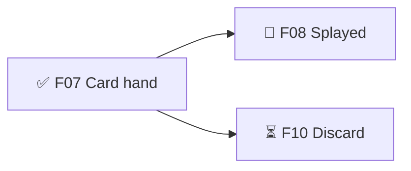

# BMUZ project files — the shared rules every command follows

**Every step triggers; nothing runs on memory** (F80 — Muzzy, 2026-10-19: "'only runs when it remembers' is a bad thing. 'always runs because it triggers' is much more solid"; "if a real indie studio would do something, we should too"). Every rule in a skill or this file says how it happens: ① a script or hook does it · ② Claude's judgement, refused until it's on record · ③ judgement only, with why. A new rule line without its mark is flagged the moment it's written (hook `rule-kind.mjs`); `rule-kind.mjs --all` lists the old ones, and the milestone look-back converts the ones that slipped. A new "Claude should remember to…" becomes a hook or a script step instead.

## Layout
```
version.json        X.Y.Z + build (~/.claude/references/versioning.md)
content/            data the game reads; Muzzy edits it in Obsidian or the Dev Kit (tuning/, anim/, text/, data/, ui/ = style.json + settings.json from game-ui, credits.json)
.planning/
  GDD.md            the design: what it is, how it plays, how it should feel, scope   (/discover /define · /gdd)
  TDD.md            the engineering plan: how it's built, standards, decisions, compliance   (/define · /tdd)
  ROADMAP.md        milestones → features with dependencies, plus Later and Ideas   (/define · /roadmap)
  SPRINT.md         the current sprint's features and tasks   (/sprint · /develop)
  BUGS.md           the bug list, P0–P3   (/bug)
  STATE.md          ▶ RESUME HERE, key facts, short log   (every command; /save rewrites it)
  design/ research/ bugs/   optional: long design specs linked from the GDD · discovery + sims · bug captures
  archive/          finished sprints, old logs, old GSD files — search it when something feels familiar
  smoke-pass        the commit the smoke test passed on (hooks/smoke-pass.mjs — live-push needs it)
  live-pass         the last live check: commit · "<tag> <url>" (or "<tag> skipped — Release: …") · time · console check (scripts/live-check.mjs)
  ppp.html          the planner page (gitignored, rebuilt by the tools)
```
Nothing else goes in `.planning/` — no summaries, no side docs ① (plan-lint names any other file there on the next plan edit). Investigations go to archive once their rules are in Key facts ③.
New project or old GSD project → `~/.claude/config/bmuz/SETUP-AND-CONVERT.md`.

## Planning model
```
RELEASE     prototype → alpha → beta → 1.0     done = all its musts done
 MILESTONE  v0.3 — Card play feels good        (ROADMAP)
  FEATURE   F07 🧱 Card hand system             (ROADMAP — has needs:)
   TASK     🤖 2. Lay out cards in an arc — Hand.tsx   (SPRINT)
```
- **Types:** ❓ decision (often Muzzy's) · 🧱 foundation others stand on · 🎮 player-facing · ✨ polish · 🔧 Dev Kit tool · 🐞 a bug big enough to need its own feature (normal bugs live in BUGS.md; an affected feature notes `LIVE BROKEN → B003`).
- **States** (only in ROADMAP): ⏳ waiting → 🟢 ready → 🔨 building → 🎛️ tuning (works, being dialled in) → ✅ done.
- **Ready rule:** all `needs:` are ✅ — or 🎛️ for `~` needs (only has to work) ① (plan-lint names a ⏳ whose needs are met — "set it 🟢", unless the line says what else it waits for: `· waits: <what>` — and a 🟢/🔨/✅ whose needs aren't).
- **Sprint rule:** a sprint may also take a feature whose needs are earlier *in the same sprint*, lined up after them.
- **❓ decisions:** 1–2 tasks; ✅ only when Muzzy answers (Claude may recommend). If he's right there, just ask.
- **Scope:** `must:<stage>` · `should` · `could` (won't-haves stay in the GDD). "Musts X/Y" counts non-❓ features. Every feature in a live milestone has a type and (❓ aside) a scope ① (plan-lint).
- **Owners:** 🤖 Claude · 🙋 Muzzy (art, decisions, feel checks on a device). Stand-in art is a task `(stand-in)`; handed-over tasks switch owner with a note.

## Project Planner Page (PPP) — pilot on Goops (2026-10-16; full rules in BMUZ-PLAN "Project Planner Page")
A read-only visual home page per game, **drawn** from GDD/ROADMAP/SPRINT/BUGS/STATE by `templates/ppp/build-ppp.mjs` (never a second source of truth) → `.planning/ppp.html` (gitignored) → published as a private Artifact; link in STATE Key facts (`Planner (PPP):`); rebuilt after every plan edit (plan-lint hook) and every save (save.mjs), and a Stop hook sends Claude back until it's republished — with any sketch changed that turn as a `files` entry ① (stop-plan-check). Pilot rules (ROADMAP): states 💡 Idea → 🔍 Discover → 📐 Define → 🔨 Develop → 🚀 Deliver → ✅ Done (+ 💤 Maybe later, ✖ Won't) · % only on milestones = done / all items · Milestone 0 "Design decided" holds the open ❓ questions · `## Parking lot` = 💡 homeless ideas + 💤 maybe-later · end-of-musts checkpoint: leftover should/could → yes stays, no → parking lot · always challenge new things mid-milestone. The old state set below still draws (mapped). Becomes the standard once the pilot holds up.
**Every section Muzzy sees is written for a non-engineer:** plain words that say whether anything needs doing, and who does it ("A newer Dev Kit is out. Claude updates it in the next /develop"). No version numbers, commands, file or test names unless he opens a "details" fold. Healthy means one green line. (Muzzy 2026-10-19, about the Framework row: "I don't know what I'm looking at … I can't make any decisions based on what is present.")
**A feature that isn't approved at sprint end gets carried over:** rename its SPRINT heading to `## Carried to sprint NN — <name> (Fxx)` with the reason, and it goes into the next sprint (archive-sprint only reads `## Fxx` headings).

## ROADMAP.md
```markdown
# <Name> — Roadmap
Release target: alpha — musts 7/9 done
## v0.2 — Playable prototype  ✅ released (prototype) 2026-10-02
## v0.3 — Card play feels good  ← current  (→ alpha)
Goal: <what a player can do when this is done>
- ✅ F07 🧱 Card hand system — must:alpha
- 🔨 F08 🎮 Splayed cards — must:alpha · needs: F07 · sprint 4
  what: <optional one-line goal>
  why: fan layout → players scan the whole hand → Mastery   ← optional MDA trace (🎮 ✨ ❓)
- ⏳ F10 🎮 Discard pile — must:alpha · needs: F09, F07

## Later
- <unscheduled features, scope if known> · Watch: B00x <patched bug that might return>
## Ideas
- 2026-10-05 — <raw idea; anyone appends; /roadmap turns good ones into features>
```
IDs are permanent. Each milestone ends with a small Mermaid graph (solid = needs, dotted = `~`) kept in sync. Milestone names needn't match version.json.
A milestone heading may end with `· target: <YYYY-MM-DD>` (the day it should be done: `## v0.3 — Card play feels good  ← current  (→ alpha) · target: 2026-11-02`); session start counts down to it from 14 days out and says when it's overdue, with the musts done ① (producer-notes.mjs).

## SPRINT.md  (1–4 features, one goal; ends when they're done)
```markdown
# Sprint 04 — <what we'll see/play at the end>
Started <date> · Milestone v0.3 · Features: F08, F11 (in this order)
## F08 🎮 Splayed cards
Done when: <what Muzzy sees/plays>
- [x] 🤖 1. Arc layout math — src/hand/layout.ts
- [ ] 🙋 2. Stand-in card fronts (stand-in)
- [ ] 🤖 3. Tune spread + overlap (tuning)
Check: <test / visual check / "Muzzy fans 7 cards on phone">     ← the test plan, written when the sprint starts
Checked: <what was run or looked at + the result: "check:fast green · Muzzy fanned 7 cards on his phone">   ← written before `F08: done`
Ask Muzzy: <open questions>   Notes: <decisions, surprises, Tuning: knob old→new — why — result>
Retro:                        ← at the end of the file, once every feature is done
- went well: <one short line>
- went wrong: <one short line>
- change: <one short line — what the next sprint does differently>
```
The retro is Muzzy's three answers (Claude may draft from Notes; his words win); archiving refuses until all three lines are filled ① (archive-sprint.mjs). Each "change" line is a lesson the milestone look-back reads ① (lookback.md step 1).
3–8 tasks per feature (❓: 1–2) ① (plan-lint); tasks name real files ② (plan-lint flags a path whose file and folder don't exist). Numbered from 01. Finished → `archive/sprints/sprint-NN.md`, commit `Sprint NN done` ① (archive-sprint.mjs; stop-plan-check sends a turn back while a finished sprint sits there). A new sprint names every open P0/P1 bug ② (plan-lint); a P1 found before the sprint's `Started` date is a task in it, or lowered to P2 with a reason ② (plan-lint). Every feature (❓ aside: Muzzy's answer is its check) has a `Check:` line ② (plan-lint), and `Fnn: done` needs a `Checked:` line in its section ② (guard-git refuses the commit without one). Starting one: commit `Sprint NN: <goal>` with STATE.md in it ② (guard-git).

## BUGS.md
```markdown
# <Name> — Bugs
Open: 5 (P0 0 · P1 1 · P2 3 · P3 1)
## Open
### B014 · P1 · open · found <date> in F08 · v0.2.0.93 · Pixel 6
<title>
Steps: 1… 2… · Expected: … · Actual: … · How often: …
## Fixed (newest first)
### B009 · P2 · verified <date> · fixed in a1b2c3d · Guarded by: tests/score.test.ts
```
P0 crash/can't continue/live broken (fix now, blocks /deliver) · P1 feature broken · P2 minor · P3 cosmetic.
Statuses: open → fixing → fixed → verified (Muzzy confirmed; required for P0/P1) · watching · can't reproduce · won't fix. Header lines keep the `### B014 · P2 · status · …` shape and `Guarded by:` names a real test file ① (plan-lint). Old fixed entries → `archive/bugs.md` after each release ③ until release.mjs moves them (proposed).

## content/credits.json  (every font, picture, sound and model the game ships — our own work too, as 🟢 "own work")
```json
[
  { "paths": ["public/icons/sword.svg", "public/icons/potion.svg"], "source": "game-icons.net",
    "author": "Lorc", "licence": "CC-BY 3.0", "light": "🟡", "url": "https://game-icons.net",
    "credit": "Icons made by Lorc. Available on https://game-icons.net" },
  { "paths": ["public/models/kenney-dice/"], "source": "Kenney", "author": "Kenney",
    "licence": "CC0", "light": "🟢", "url": "https://kenney.nl/assets/...", "credit": "" }
]
```
Light and credit lines come from `~/.claude/references/indie-toolkit.md`. 🟡 → the `credit` line must show in the game's Credits screen. 🔴 → never ships. `npm run check:framework` checks all three ① (UI kit 0.19+: every file listed, nothing 🔴, every 🟡 credit shown). organize-assets keeps it up to date.

## Checks — how much to run, and when  (Muzzy, 2026-10-04: "learn from this… move more optimally through testing and delivery")
Learned in Glyphtender v0.6 (13 sprints in a night): the time went into running the SAME slow checks twice (helper, then
Claude after the merge) and running every e2e script one at a time. Three tiers, one command each (a web game has
`npm run check:fast` / `npm run check:full` — template `templates/check-all.mjs`; e2e scripts each get their own port so
they run side by side, 3 at a time). Hooks enforce parts of this (`HOOKS.md`): type check before every commit, check:fast
before /develop hands back, a smoke pass before anything goes live:
| Tier | What | When | Time (Glyphtender) |
|---|---|---|---|
| **Fast** | unit tests · type check + build · lint · golden games / sims if any — together | every task, every merge, before every commit | ~1 min |
| **Area** | Fast + the e2e scripts for what the change touched (`check:full -- online game`) — Key facts "Checks" maps areas → scripts | a helper finishing a task; a fix | 3–8 min |
| **Full** | Fast + every e2e script + screenshots, side by side → `e2e-shots/checks.html` (link it) | ONCE per feature, after its merges, before the hand-off — and at /deliver only if code changed since | ~10–15 min |
Rules:
- **GitHub re-checks every push** (F70): `.github/workflows/checks.yml` (from `templates/checks.yml`) runs check:fast + check:framework on every branch push — red cross = broken commit. /deliver refuses to merge or release while the branch's latest run is red or still running (`scripts/checks-gate.mjs`, and `release.mjs` again after the merge).
- **A helper runs Area, not Full** ③ (orchestration — it's in the brief). Claude runs Full once after merging — that catches the combination problems (two pieces of work that each pass alone) a helper can't see. Never both.
- **After a merge:** Fast only when the merge was clean and the helpers touched different files; Area for the overlapping area when git had to combine or resolve the same file.
- **Record it:** after a green Full, write `Last full check: <commit> — all green (<date>)` in STATE Key facts. /deliver reuses it when HEAD is that commit (or only docs / .planning changed since): Fast + smoke + live check, no Full re-run.
- **Reviews:** `/code-review` (low) per feature, on that feature's commits — a whole-branch diff is too big to read in one pass. Record `Reviewed through: <commit>` in STATE; /deliver reviews only what's newer + runs `/security-review` once on the branch.
- Never hand Muzzy a command to run — run it, then link the results page ② (handoff-check sends back a card whose local links don't answer) · ③ the manner.

## STATE.md  (under ~120 lines)
```markdown
## ▶ RESUME HERE
<2–5 lines: where things stand, the exact next action, `Muzzy: …` lines for his to-dos. Always REPLACE, never append.>
## Where we are
Stage · Milestone · Sprint · Doing · Branch · Version · Live (url + release stage)
## Key facts
<~40 lines max, under bold labels (Run/deploy, Rules, Architecture, Don't re-break). Prune stale ones.>
Release: <platform> | none (library) | not set up (declined <date>) | <platform> — blocked: <why>
Last full check: <commit> — <date> <result>   ·   Reviewed through: <commit>   ·   Security reviewed: <commit>
<Don't re-break includes test-infrastructure facts when they bite (ports, e2e run order).>
## Log
<newest first, one line per /save; keep 10, older → archive/log.md>
```
